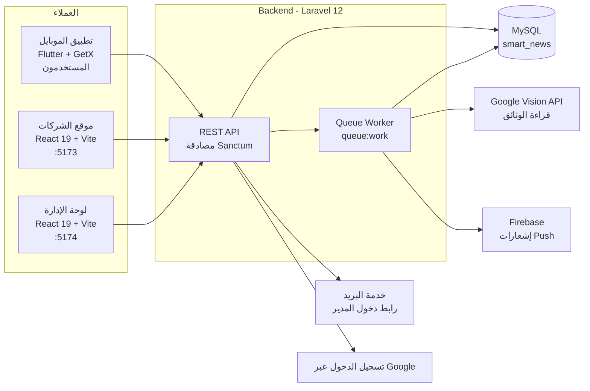
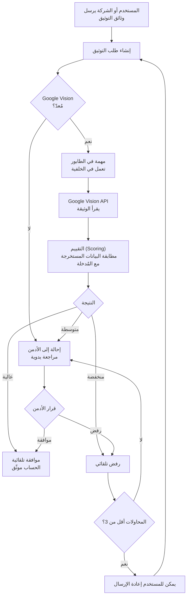

<div dir="rtl">

# 📰 Smart Platform for News

> منصة مهنية لنشر المحاضرات والمعارض والفعاليات والدورات ومتابعتها: الشركات تنشر محتواها وتميّزه، والمستخدمون يتابعون ويتفاعلون ويقيّمون، والإدارة توثّق الحسابات وتراقب المحتوى.


---

## 📌 نظرة عامة

Smart Platform for News هي منصة مهنية لنشر المحاضرات والمعارض والفعاليات والدورات ومتابعتها. الشركات تنشر محتواها وتميّزه، والمستخدمون يتابعون ويتفاعلون ويقيّمون، والإدارة توثّق الحسابات وتراقب المحتوى.

المشروع عبارة عن monorepo مؤلّف من ثلاثة أجزاء: واجهة API بـ Laravel مع قاعدة بيانات MySQL، وتطبيق ويب بـ React يخدم موقعين من قاعدة كود واحدة (موقع الشركات ولوحة الإدارة)، وتطبيق موبايل بـ Flutter للمستخدمين.

---

## ✨ الميزات الرئيسية

- **نشر المحتوى للشركات** — تنشر الشركات المحاضرات والمعارض والفعاليات والدورات، ويمكنها تمييز محتواها
- **تفاعل المستخدمين** — يتابع المستخدمون المحتوى ويتفاعلون معه ويقيّمونه
- **توثيق الحسابات** — تُقرأ وثائق التوثيق تلقائياً عبر Google Vision API، وعند عدم إعداده تُحال طلبات التوثيق إلى الأدمن يدوياً
- **لوحة الإدارة** — توثّق الإدارة الحسابات وتراقب المحتوى، ويتم دخول المدير عبر رابط يُرسل إلى بريده
- **إشعارات Push** — تصل لمستخدمي الموبايل عبر Firebase
- **معالجة في الخلفية** — الأعمال الثقيلة تُنفَّذ عبر طوابير (Queues) خارج دورة الطلب
- **مصادقة الـ API بالتوكن** — مؤمَّنة عبر Laravel Sanctum
- **تسجيل الدخول بحساب Google** — مدعوم في تطبيق الموبايل عبر Google Client ID

---

## 🏗️ المعمارية (Architecture)



**ملاحظات:**
- 🌐 موقع الشركات ولوحة الإدارة موقعان منفصلان يُبنيان من **قاعدة كود واحدة** (`web/`)
- 📨 الأعمال الثقيلة (توثيق الوثائق، إشعارات Push) تعمل في **طابور الخلفية** (`QUEUE_CONNECTION=database`)
- 🔌 Google وFirebase اختياريان وقت التشغيل: بدون ملفي حساب الخدمة يتحول التوثيق إلى مراجعة الأدمن اليدوية وتتعطل الإشعارات، ويبقى باقي النظام يعمل

---

## 🔍 مسار التوثيق (Verification Pipeline)



**آلية العمل:**
- 🧾 تُقرأ الوثائق عبر **Google Vision API** من خلال مهمة في الخلفية
- 📊 خطوة التقييم تحدد بين **الموافقة التلقائية** و**المراجعة اليدوية** و**الرفض التلقائي**
- 🔁 لكل حساب حد أقصى **ثلاث محاولات توثيق**
- 🛟 إذا لم يتوفر Vision تذهب الطلبات مباشرة إلى الأدمن، فلا يتعطل التوثيق أبداً

---

## 🛠️ التقنيات المستخدمة (Tech Stack)

| الطبقة | التقنية |
|---|---|
| الـ API | Laravel 12، Sanctum |
| قاعدة البيانات | MySQL |
| الويب (موقع الشركات + لوحة الإدارة) | React 19، TypeScript، Vite، Tailwind |
| الموبايل | Flutter، GetX |
| توثيق الوثائق | Google Vision API |
| إشعارات Push | Firebase |
| المعالجة في الخلفية | Laravel Queues (بمشغّل database) |

---

## 📂 مكوّنات المشروع

| المجلد | الوصف | التقنية |
|---|---|---|
| `backend/` | الـ API وقاعدة البيانات | Laravel 12، MySQL، Sanctum |
| `web/` | موقع الشركات ولوحة الإدارة (موقعان من قاعدة كود واحدة) | React 19، TypeScript، Vite، Tailwind |
| `mobile/` | تطبيق المستخدمين | Flutter، GetX |

---

## ⚙️ التشغيل

### 1. الـ Backend

```bash
cd backend
composer install
cp .env.example .env
php artisan key:generate
php artisan migrate --seed
php artisan serve --host=0.0.0.0 --port=8000
```

يحتاج قاعدة بيانات MySQL، وإعدادات البريد وGoogle وFirebase في ملف `.env` (انظر `.env.example`).
أنشئ قاعدة بيانات فارغة باسم `smart_news` (أو غيّر `DB_DATABASE` في `.env`) قبل تشغيل `migrate`.

#### ملفات Google وFirebase (لا تُرفع إلى الريبو)

ضع ملفي حساب الخدمة الخاصين بمشروعك على Google Cloud في المسار التالي:

- `backend/storage/app/google/vision.json`: لقراءة وثائق التوثيق (Vision API)
- `backend/storage/app/google/firebase.json`: لإشعارات Push (Firebase)

بدونهما تُحال طلبات التوثيق إلى الأدمن يدوياً، وتتعطل الإشعارات، ويبقى باقي النظام يعمل.

#### معالجة الطلبات في الخلفية

الإعداد الافتراضي `QUEUE_CONNECTION=database` يحتاج تشغيل:

```bash
php artisan queue:work
```

أو غيّر القيمة إلى `sync` في `.env` للتجربة المحلية بدون worker.

### 2. الويب

```bash
cd web
cp .env.example .env   # على ويندوز: copy .env.example .env
npm install
npm run dev
```

- موقع الشركات: `http://localhost:5173`
- لوحة الإدارة: `http://localhost:5174` (الدخول برابط يُرسل إلى بريد المدير)

### 3. تطبيق الموبايل

```bash
cd mobile
flutter pub get
cp dart_defines.example.json dart_defines.json   # على ويندوز: copy dart_defines.example.json dart_defines.json
flutter run --dart-define-from-file=dart_defines.json
```

قبل التشغيل:

- عدّل `dart_defines.json`: ضع عنوان الـ API (على الموبايل الحقيقي استخدم IP جهازك على الشبكة، وعلى الـ emulator استخدم `10.0.2.2`) وGoogle Client ID الخاص بمشروعك.
- ضع ملف `google-services.json` الخاص بمشروعك على Firebase في `android/app/`.

---

## 🧪 الحسابات التجريبية

بعد `php artisan migrate --seed` (كلمة المرور: `password`):

- مستخدم: `user@test.com`
- مستخدم موثّق: `verified@test.com`
- شركة: `company@test.com`

> هذه الحسابات وكلمة المرور `password` للتجربة المحلية فقط. وغيّر `ADMIN_PASSWORD` في `.env` قبل أي نشر حقيقي، ولا تشغّل الـ seeders على بيئة إنتاج.

---

## 👤 المطوّر / التواصل

**Badr AlDeen AlSaudi** — مهندس برمجيات (تطوير الويب)

- LinkedIn: [www.linkedin.com/in/badr-al-deen-sudi]
- Email: [badrdsudi14@gmail.com]
- GitHub: [https://github.com/BADR-14]

---

## 📄 الرخصة

هذا المشروع مرخّص بموجب رخصة MIT، راجع ملف [LICENSE](LICENSE) للتفاصيل.

</div>
